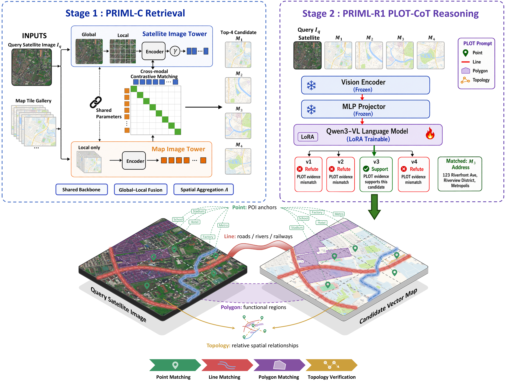
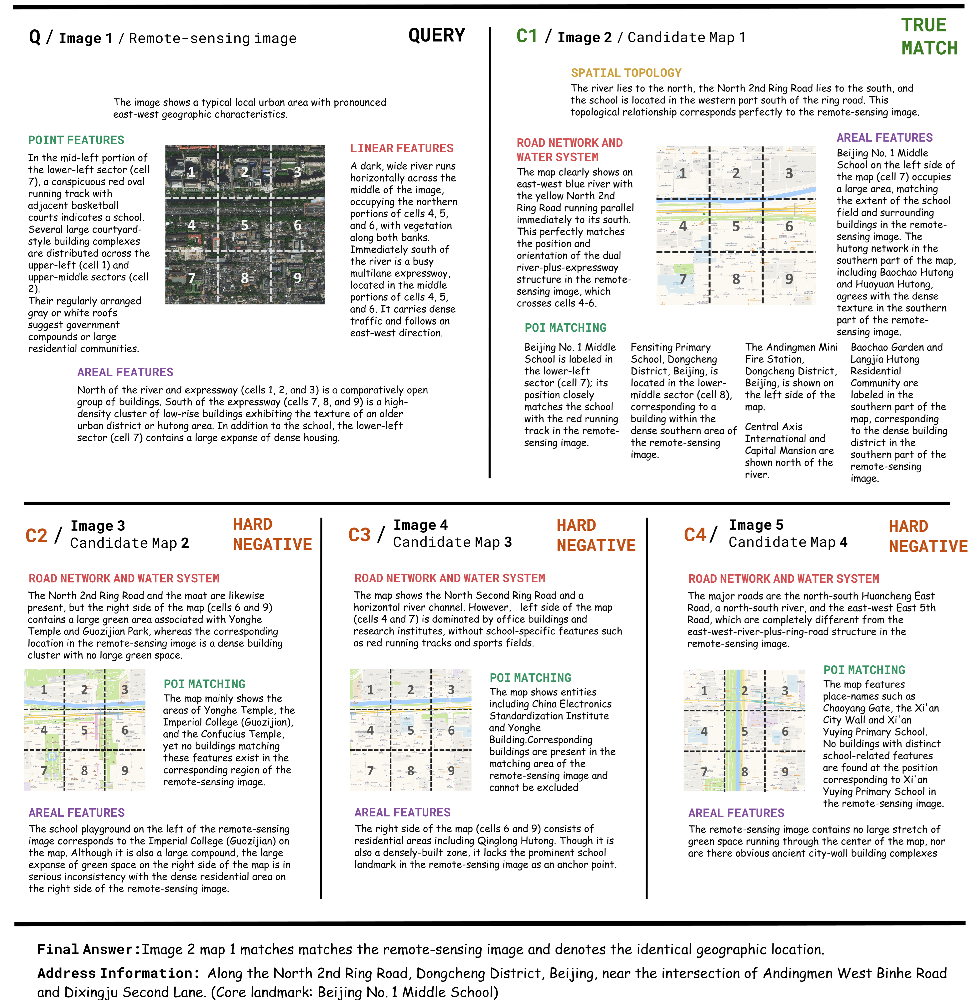

<h1>Why Here? Verifiable Geo-Localization of Remote Sensing Imagery against Maps with Vision–Language Models</h1>

<b>PRIML</b>: <b>P</b>rogressive <b>R</b>easoning for <b>I</b>mage-to-<b>M</b>ap <b>L</b>ocalization

Yuchen Wei1,
Pengfei Gao1,
Ke Li1,*,
Xuanbei Lu1,
Yue Zhou2,3,
Xue Yang4

1Information Engineering University   
2Hinton STAI Institute & Key Laboratory of Geographic Information Science (Ministry of Education), East China Normal University 
3School of Geospatial Artificial Intelligence, East China Normal University   
4Shanghai Jiao Tong University

*Corresponding author

> [!NOTE]
> The paper is currently under review. Code, the PRIML-Bench benchmark, and model weights will be released progressively. Please star or watch this repository to follow updates.

## News

- **[2026-10]** Repository created. Code, data, and models will be released progressively.

## Overview

  

<em>The two-stage PRIML framework. PRIML-C retrieves candidate map tiles; PRIML-R1 verifies them through PLOT reasoning and outputs the matched tile with its street-level address.</em>

Geo-localization of remote sensing imagery against electronic maps is usually solved by cross-modal retrieval, which returns the most similar map tile but provides no evidence for the match. PRIML instead reasons over the same primitives a map is built from (points, lines, polygons, and their topology), so every localization decision comes with an inspectable, item-by-item reasoning trace.

- **PRIML-C**: a cross-modal contrastive retriever that compresses a city-scale map-tile library into a compact candidate set.
- **PRIML-R1**: a vision–language reasoner that verifies each candidate and outputs the matched tile and a street-level address.
- **PLOT** (Point, Line, pOlygon, Topology): a spatial reasoning schema that decomposes holistic map matching into verifiable geographic-fact checks, instantiated as the reasoning chain **PLOT-CoT**.
- **PLOT-GRPO**: group relative policy optimization with verifiable rewards for format adherence, judgment correctness, and agreement of the cited evidence with expert annotations.
- **PRIML-Bench**: to our knowledge, the first benchmark for reasoning-based image-to-map geo-localization.

## PRIML-Bench

| Item                  | Description                                                                                                          |
| :-------------------- | :------------------------------------------------------------------------------------------------------------------- |
| Cities                | 20 Chinese cities covering four urban morphologies                                                                   |
| Split                 | City-disjoint: 16 training cities / 4 held-out test cities                                                           |
| Retrieval sub-dataset | 33,077 satellite image–map tile pairs                                                                               |
| Reasoning sub-dataset | 4,200 expert-verified samples (3,000 train / 1,200 test)                                                             |
| Each reasoning sample | 1 query image, 4 candidate map tiles (1 true match + 3 hard negatives), a PLOT-CoT trace, and a street-level address |

## Main Results

All results are reported on the four held-out cities, which are never seen during training.

**Retrieval** (6,930 queries against the 33,077-tile library of all 20 cities)

| Method                    |       R@1       |       R@4       |      R@10      |
| :------------------------ | :-------------: | :-------------: | :-------------: |
| Vanilla Siamese (trained) |      66.50      |      83.94      |      90.95      |
| **PRIML-C**         | **80.27** | **92.22** | **95.89** |

**Reasoning** (1,200 four-choice samples; chance-level ACC = 25%)

| Model                                 |       ACC       |       AA       |       SRS       |       GRS       |
| :------------------------------------ | :-------------: | :-------------: | :-------------: | :-------------: |
| Best of 8 LVLM baselines† |      31.50      |      29.44      |      66.96      |      14.24      |
| PRIML-R1 (SFT)                        |      65.83      |      53.67      |      78.35      |      45.29      |
| **PRIML-R1 (PLOT-GRPO)**        | **80.42** | **61.12** | **86.81** | **50.97** |

† Best value of each metric, which may come from different baselines.
ACC: matching accuracy; AA: address accuracy; SRS: structured reasoning score; GRS: grounded reasoning score.

End to end, PRIML localizes 74.16% of the 6,930 unseen-city queries to the correct map tile, with an address accuracy of 56.36%.

## Qualitative Example

  

<em>Five baseline LVLMs all select the wrong tile. PRIML-R1 rejects Maps 1–3 by citing explicit contradictions, verifies Map 4 along the four PLOT dimensions, and outputs the street-level address.</em>

## Citation

If you find this work helpful, please consider citing our paper. The BibTeX entry will be added once the paper is published.

## Data Attribution

Map data © OpenStreetMap contributors, available under the Open Database License (ODbL). Satellite imagery shown in the figures is from Google Earth.

## Contact

For questions, please open an issue or contact Yuchen Wei (weiyuchen0430@163.com).
